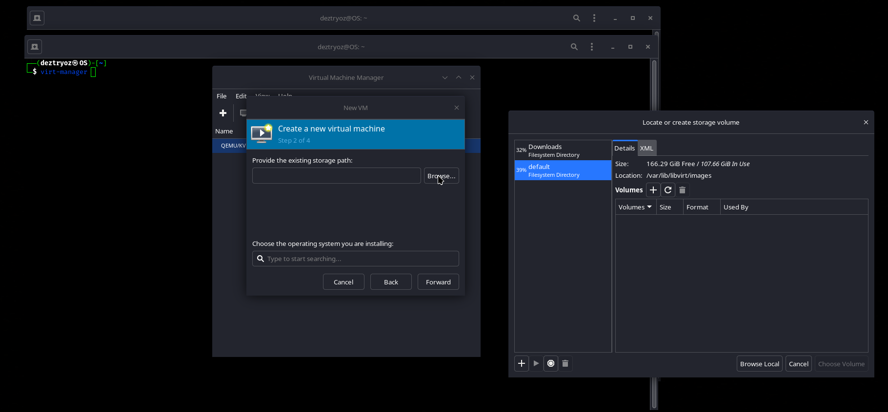
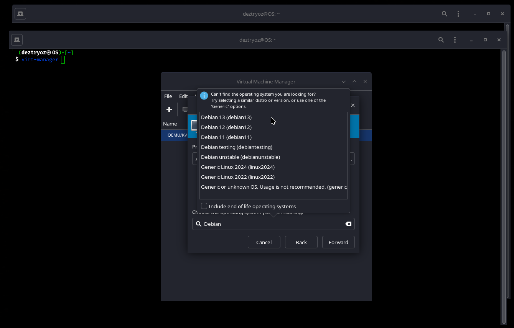
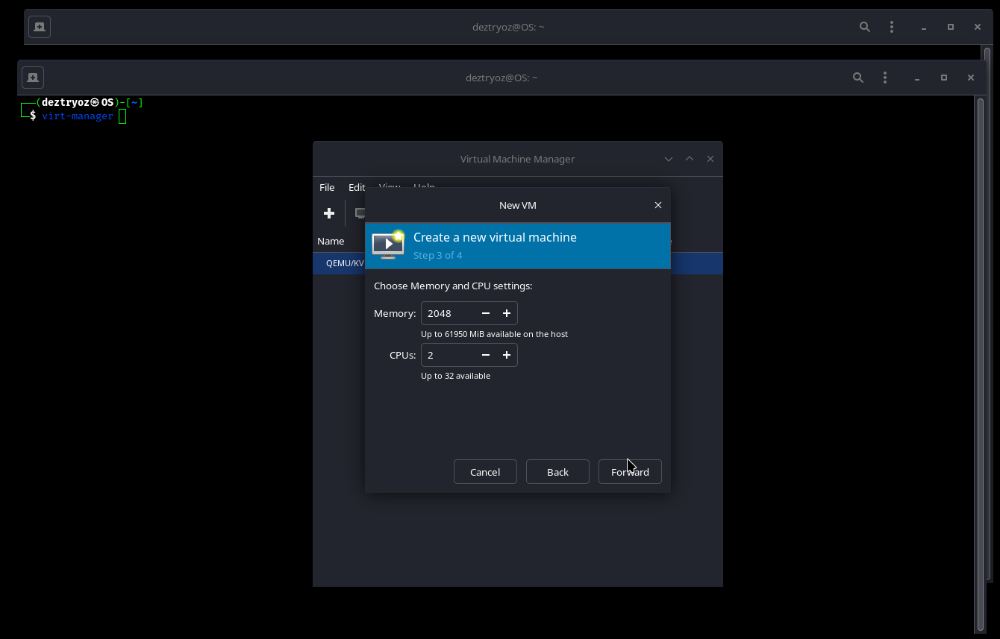
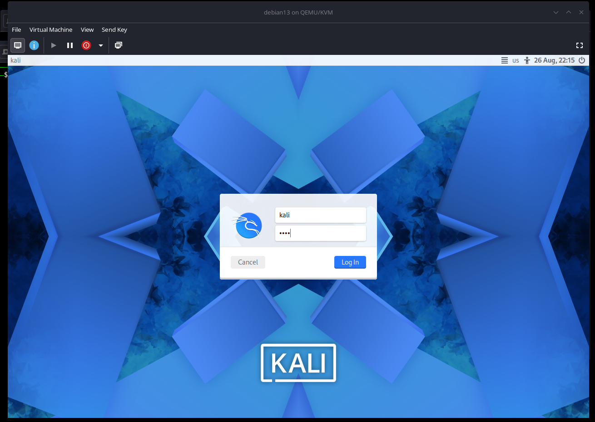

Importing the [Kali QEMU image](/get-kali/#kali-virtual-machines) with `virt-manager` is very straightforward.

We first need to extract the downloaded QEMU image:

```console
kali@kali:~$ 7z x kali-linux-<VERSION>-qemu-amd64.7z
[...]
kali@kali:~$
```

This will extract the pre-built Kali `.qcow2` disk image.

If `virt-manager` is not already installed, we can install it with:

```console
kali@kali:~$ sudo apt update && sudo apt install virt-manager -y
[...]
```

We then launch `virt-manager` and create a new virtual machine.

From here we select **Import existing disk image**:


We then select the extracted Kali `.qcow2` disk image:



If `virt-manager` does not automatically detect the operating system, we disable automatic detection and manually select an appropriate Debian version:



We can now configure the amount of memory and CPU cores assigned to the virtual machine. In this example, we use 2 GB of memory and 2 CPU cores:



We can now review the virtual machine configuration, change the VM name if needed, and make any additional changes before finishing the setup:


Once we are happy with the configuration, we finish creating the virtual machine and start it.



The pre-built Kali QEMU image should now boot normally. The default login is `kali` for the user and `kali` for the password.
